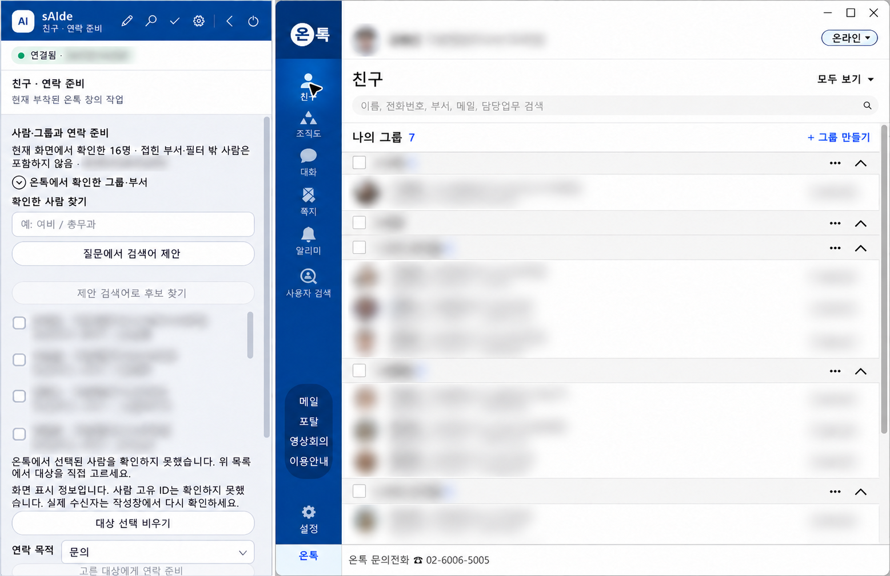
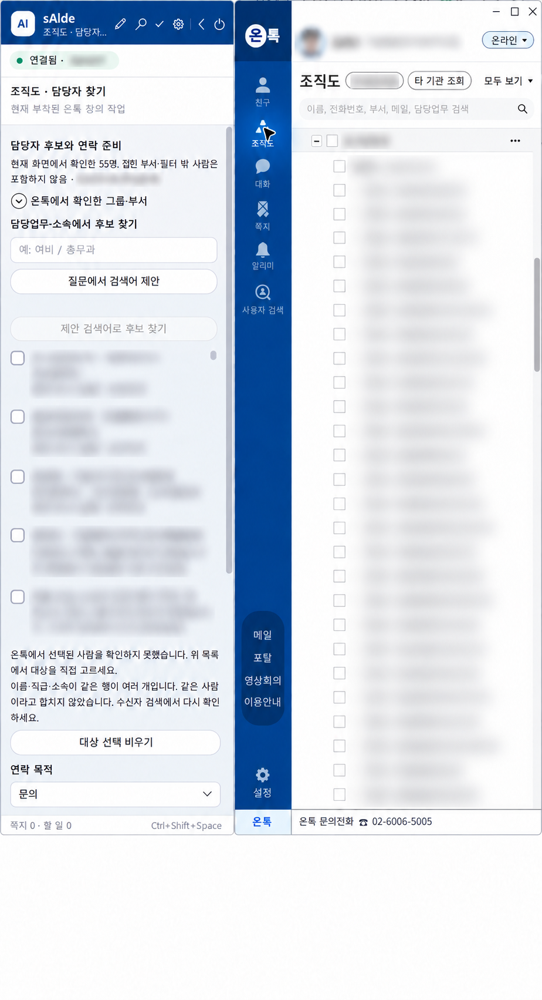
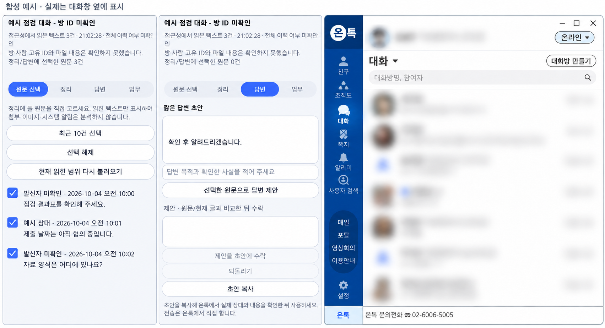
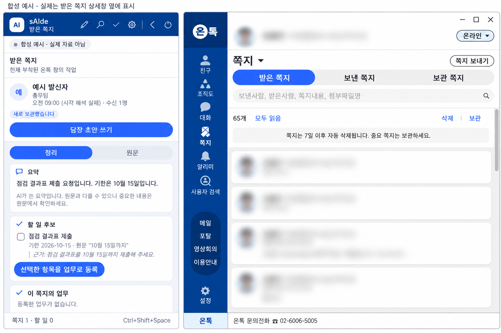

# onTalk.sAIde 사용자 매뉴얼

온톡에서 지금 하는 일에 맞춰 옆 패널이 바뀌는 Windows 업무 도우미입니다. 친구에서는 연락할 사람을 준비하고, 조직도에서는 담당자 후보를 찾으며, 쪽지를 읽을 때는 내용과 할 일을 정리합니다. 쪽지 작성과 대화 답변에는 초안 편집과 로컬 AI 제안을 제공합니다.

**기준: 2026-10-04 개발 소스, 문맥별 사이드카 4차 및 쪽지 메뉴 감지 수정.** 기존 0.3.1 배포 ZIP은 갱신하지 않았습니다. 최신 기능은 현재 소스의 개발 빌드나 새로 만든 배포 묶음에서 사용하세요. [구현 현황](docs/implementation-status.md)과 [호환성 표](docs/compatibility-matrix.md)에서 확인 수준을 볼 수 있습니다.

## 목차

- [실행과 첫 연결](#실행과-첫-연결)
- [패널 조작](#패널-조작)
- [친구: 연락 준비](#친구-연락-준비)
- [조직도: 담당자 후보 찾기](#조직도-담당자-후보-찾기)
- [대화: 방 찾기와 답변](#대화-방-찾기와-답변)
- [쪽지: 목록과 읽기](#쪽지-목록과-읽기)
- [쪽지 작성](#쪽지-작성)
- [검색·업무·첨부](#검색업무첨부)
- [로컬 AI](#로컬-ai)
- [백업과 자료 관리](#백업과-자료-관리)
- [문제 해결](#문제-해결)
- [개발과 문서 안내](#개발과-문서-안내)

## 실행과 첫 연결

### 최신 개발 빌드

Windows와 .NET SDK 10이 설치된 개발 PC의 PowerShell에서 실행합니다.

```powershell
Set-Location D:\Dev\onTalk.sAIde
dotnet build OnTalk.Sidecar.sln -c Release
& .\src\OnTalk.Sidecar.App\bin\Release\net10.0-windows\OnTalk.sAIde.exe
```

갱신할 때는 실행 중인 사이드카를 전원 단추로 먼저 종료하세요. DLL이 잠겨 빌드에 실패할 수 있습니다. 온톡은 계속 실행해도 됩니다.

### 배포 폴더

ZIP의 **전체 압축을 풀고** 안의 `OnTalk.sAIde.exe`를 실행합니다. EXE 하나만 옮기면 필요한 DLL이 없습니다. `scripts/publish.ps1`로 만든 묶음은 .NET 런타임을 포함합니다.

1. 온톡을 실행하고 로그인합니다.
2. 사이드카를 실행합니다.
3. 첫 연결 안내의 계정이 본인인지 확인하고 **이 계정으로 연결**을 누릅니다.
4. 온톡 메인 메뉴를 옮겨 패널 제목도 친구·조직도·대화·쪽지에 맞춰 바뀌는지 봅니다.

확인 전에는 쪽지 내용을 읽어 보관하지 않습니다. 확인한 계정은 다음 실행에서 다시 연결합니다. 계정 후보는 온톡 프로필 폴더 메타데이터로 추정하므로 직접 확인하세요.

개발 빌드는 저장소 **스키마 8**입니다. 이전 DB 사본을 남기고 올리며 같은 저장소를 구버전 실행 파일과 번갈아 사용하지 마세요.

## 패널 조작

현재 쓰는 온톡 창 옆에 붙어 같은 높이로 따라갑니다. 오른쪽 공간이 부족하면 왼쪽에 붙고, 양쪽 공간이 없으면 온톡 가장자리에 좁은 도구를 표시합니다. 이때 펼치면 온톡 위에 겹칩니다.

| 도구 | 방법 |
|---|---|
| 접기 | 머리줄 `‹` 또는 패널에서 Esc |
| 펼치기 | 좁은 도구의 **AI**, **Ctrl+Shift+Space**, 알림 영역 아이콘 |
| 새 초안 | 연필. 작성 중에는 확장 작성 도우미 |
| 검색 | 돋보기. 이 계정에 보관한 자료 검색 |
| 업무 | 체크 아이콘. 할 일·기한·완료 상태 |
| 관리 | 톱니바퀴. 모델·백업·복구·삭제 |
| 종료 | 전원, 알림 영역 **끝내기**, `OnTalk.sAIde.exe --quit` |

다른 앱을 쓰면 숨고 온톡으로 돌아오면 나타납니다. 단축키로 직접 연 패널은 온톡을 다시 사용할 때까지 표시를 유지합니다. 종료해도 온톡은 종료되지 않습니다.

**메인 화면 · 메뉴 확인 필요**가 나오면 아래 메뉴 선택으로 직접 지정할 수 있습니다. 사이드카 화면만 바꾸며 온톡 메뉴·사람 선택을 바꾸지 않습니다. 자동 감지가 회복되면 자동으로 돌아갑니다. 사용자 검색·알리미는 전용 지원 대상에서 제외하며 공통 도구만 제공합니다.

아래 메인 화면 이미지는 **실제 온톡과 사이드카를 각각 캡처해 나란히 편집한 안내 이미지**입니다. 얼굴·이름·계정·소속·본문 등은 AI 이미지 편집으로 강하게 흐림 처리했습니다. 편집 과정에서 크기·간격이 달라질 수 있으며 픽셀 단위 검증 자료는 아닙니다. ‘합성 예시’는 실제 WPF 화면을 가상 자료로 렌더링한 것입니다. [이미지 제작 기록](docs/manual-images.md)에서 출처와 개인정보 처리를 확인할 수 있습니다.

## 친구: 연락 준비



여러 사람에게 자료를 요청하거나 자주 연락할 대상 목록을 준비할 때 사용합니다. 현재 화면에서 확인한 사람의 이름·직급·소속·온라인 표시를 보여 줍니다.

1. 온톡 **친구**를 엽니다.
2. **확인한 사람 찾기**에 이름·소속 등의 글자를 입력합니다.
3. 연락할 사람을 체크합니다. 온톡 선택 신호가 읽히지 않아도 사이드카에서 직접 고를 수 있습니다.
4. **연락 목적**에서 문의·진행 확인·자료 요청·감사를 고릅니다.
5. **고른 대상에게 연락 준비**로 초안 뼈대와 후보를 작성 도우미에 넘깁니다.
6. 실제 온톡 작성창에서 수신자를 검색하고 **소속까지 확인한 뒤** 추가합니다.

**온톡에서 확인한 그룹·부서**를 펼치고 범위를 고르면 읽힌 구성원만 고를 수 있습니다. 이름을 적어 **연락 준비 그룹**으로 저장하면 다시 불러올 수 있습니다. 사이드카 계정에 후보를 저장하는 기능으로 온톡 ‘나의 그룹’을 수정하지 않습니다. 저장 당시 정보이므로 인사이동 여부를 다시 확인하세요.

한 사람을 고르면 같은 발신자 이름의 보관 쪽지 후보가 나옵니다. 원문·소속을 확인하고 **이 사람의 자료로 직접 연결**할 수 있습니다. 이름 일치만으로 동일인이라고 확정하지 않습니다.

## 조직도: 담당자 후보 찾기



누구에게 문의할지 좁힐 때 사용합니다. 온톡에서 펼친 기관·부서의 사람과 확인된 담당업무를 이용합니다.

1. 온톡 **조직도**에서 필요한 부서를 펼칩니다.
2. **담당업무·소속에서 후보 찾기**에 `여비`, `총무과` 같은 글자를 입력합니다.
3. 일치 근거와 소속을 보고 후보를 체크합니다.
4. **선택한 사람의 담당업무·연락처**를 펼쳐 확인된 상세와 확인 시각을 봅니다.
5. 연락 목적을 정하고 **고른 대상에게 연락 준비**로 문의 초안을 만듭니다.

`출장 정산은 누구에게 문의하나요?`처럼 질문하고 **질문에서 검색어 제안**을 사용할 수도 있습니다. AI 검색어를 검토한 뒤 **제안 검색어로 후보 찾기**를 누르면 관찰 정보의 글자 일치로 후보를 찾습니다. AI가 담당자를 확정해 주는 기능은 아닙니다.

접힌 부서·필터 밖 사람·읽히지 않은 상세는 검색 범위에 없습니다. 실제 온톡 체크 상태가 노출되지 않는 경우에는 사이드카에서 직접 선택하세요. 동명이인은 이름·직급·소속을 함께 비교합니다.

## 대화: 방 찾기와 답변


메인 **대화**의 **대화방 찾기**에 방 이름·표시 참여자의 글자를 입력합니다. 관찰한 목록 안에서 찾으며 미리보기로 대화 전체를 요약하지 않습니다. 온톡에서 방을 열면 **대화 지원**으로 바뀝니다.

다음은 **대화창 지원 합성 예시**입니다. 개인정보를 흐림 처리한 메인 대화 목록과 별도 대화창에 붙는 패널의 가상 자료 화면을 함께 배치했습니다. 한 시점의 실제 부착 화면을 뜻하지 않습니다.



| 탭 | 순서와 결과 |
|---|---|
| **원문 선택** | 사용할 텍스트를 체크하거나 **최근 10건 선택** |
| **정리** | **선택한 원문 흐름 정리** → 요약·결정·질문·요청 후보와 인용 근거 확인 |
| **답변** | 직접 글을 쓰거나 **선택한 원문으로 답변 제안** → 비교 → **제안을 초안에 수락** → 필요하면 **되돌리기** |
| **업무** | 원문·제목·인용·기한 선택 → **원문 근거와 함께 업무 등록** |

새 메시지가 와도 선택한 원문·초안을 자동 교체하지 않습니다. 변화 안내를 보고 **현재 읽힌 범위 다시 불러오기**를 누른 뒤 원문을 다시 고릅니다. 한 번의 AI 처리는 최대 80건·본문 합계 12,000자입니다.

**현재 대화 답변은 ‘초안 복사’로 사용합니다.** 온톡의 실제 상대에게 붙여넣고 글을 확인한 뒤 직접 전송하세요. 입력 글 가져오기·비교·직접 반영은 합성 시험용 구현이 있지만 실제 입력 요소를 확인하지 못해 제품에 노출하지 않습니다.

전체 이력·첨부·이미지·시스템 알림을 모두 읽는 것은 아닙니다. 발신자 근거가 없으면 ‘발신자 미확인’입니다. 대화 원문과 AI 정리는 메모리에서 사용하며 업무로 등록한 텍스트와 작성한 초안은 보관됩니다.

## 쪽지: 목록과 읽기


메인 **쪽지**에서 **보관한 쪽지에서 찾기**로 로컬 보관 자료를 검색하고 **새 쪽지 준비**로 초안을 시작합니다. 온톡 받은·보낸·보관 목록 전체를 가져오는 기능은 아닙니다.

이번 수정은 실제 경로 `#/notes`와 `받은 쪽지·보낸 쪽지·보관 쪽지` 탭을 인식합니다. 목록 로딩 중에도 경로로 감지합니다. 메뉴 감지와 모든 쪽지 수집은 별개입니다.

### 받은 쪽지 읽기



메인 화면 옆에 **받은 쪽지 상세창용 패널 합성 예시**를 배치한 안내 이미지입니다. 실제 사용에서는 온톡에서 연 상세창 옆에 붙습니다.

1. 온톡에서 받은 쪽지를 엽니다. 연결 계정의 쪽지를 안정적으로 읽으면 자동 보관합니다.
2. **정리**에서 요약·요청·기한·업무 후보를 확인합니다.
3. 근거 문장을 보고 내가 맡을 항목을 체크해 **선택한 항목을 업무로 등록**합니다.
4. **원문**에서 실제 문장·첨부를 확인합니다.
5. 답변이 필요하면 초안을 준비하고 온톡에서 실제 답장창을 엽니다.

AI가 없으면 원문에서 할 일로 보이는 문장을 그대로 추린 후보를 제공합니다. AI 요약과 기한은 원문을 확인하세요. 본문에 없는 기한이나 담당자를 자동 확정하지 않습니다.

앱이 켜져 있는 동안 열어 읽은 받은 쪽지만 보관합니다. 온톡에는 7일 이후 삭제 안내가 있으므로 남길 쪽지는 그 전에 열고 첨부도 따로 저장해 가져오세요. 온톡의 보관 단추와 사이드카 로컬 사본은 별개입니다.

쪽지 상세에 연도·초·고유 번호가 없으면 일부 시각은 추정해 표시합니다. 같은 사람이 같은 분에 같은 본문을 두 번 보내면 한 건으로 합쳐질 수 있습니다. 보낸·보관 쪽지 상세 수집은 실제 미검증입니다.

## 쪽지 작성


메인 화면과 **새 쪽지 작성창용 패널 합성 예시**입니다. 실제 사용에서는 해당 작성창 옆에 붙습니다.

| 종류 | 준비할 내용 |
|---|---|
| 새 쪽지 | 목적·핵심 사실·요청사항 |
| 답장 | 원문의 질문·요청에 대한 응답 |
| 전체답장 | 모두에게 필요한 응답과 실제 전체 수신자 확인 |
| 전달 | 전달 이유·다음 행동·원문·첨부 포함 여부 |

1. 온톡에서 작성창을 열고 패널의 작성 종류를 확인합니다.
2. 직접 쓰거나 문구를 골라 **선택한 문구 넣기**를 누릅니다.
3. 요청을 적고 **AI로 제안**을 누릅니다. 제안은 편집기를 바로 덮어쓰지 않습니다.
4. 비교 후 **제안을 초안에 적용**하고 필요하면 **되돌리기**를 누릅니다.
5. 인용 포함 여부·바이트 표시를 보고 **현재 온톡 창에 반영**합니다.
6. 온톡의 글이 바뀌어 충돌하면 최신 본문을 확인합니다. **온톡의 최신 글 가져오기**로 다시 시작할 수 있습니다.

**반영은 전송이 아닙니다.** 온톡 본문·바이트를 다시 읽어 확인합니다. 미완성 `{확인할 내용}`은 먼저 고치세요. 종류·창 세션별로 초안을 나누고 바뀐 작업에는 오래된 AI 제안을 적용하지 않습니다.

연필로 **확장 작성 도우미**를 열면 큰 편집 화면·보관 초안·수신자·예약 도구를 사용할 수 있습니다. 초안 복구는 본문을 불러오며 수신자·예약을 자동 복원하지 않습니다.

### 수신자·예약·전송

- **수신자:** **온톡에서 찾기**로 검색하고 직급·소속을 확인해 추가합니다. 연락 후보를 준비한 것만으로 실제 수신자가 추가되지는 않습니다.
- **예약:** 날짜·시각을 고르고 **온톡에 설정**한 뒤 실제 표시를 확인합니다. 등록된 예약의 조회·수정·취소는 온톡에서 합니다.
- **전송:** 확장 도우미 **전송…**에서 받는 사람·본문·예약·SMS 상태를 확인하고 확인 창에서 승인합니다. 일반 작성 패널은 전송 단추를 제공하지 않습니다.

과거 즉시 전송 1건과 사용자 보고에 따른 예약 전송 성공 기록이 있습니다. 최신 네 작성 종류의 실제 전송 검증을 모두 마쳤다는 뜻은 아닙니다. 작성창이 닫히는 것까지 확인하며 배달 완료를 보장하지 않습니다. 불확실한 결과를 자동 재전송하지 않습니다. 온톡에서 직접 넣은 수신자는 소속 근거가 없어 ‘이름만 확인’으로 표시될 수 있습니다.

## 검색·업무·첨부

### 검색

돋보기에서 발신자·본문·첨부파일명·추출한 첨부 내용의 글자를 찾습니다. 임베딩 모델이 있으면 뜻이 비슷한 쪽지도 참고 결과로 제공합니다. 관련 없는 결과가 섞일 수 있으므로 문자 일치와 구분해 원문을 확인하세요. 대화 전체 자동 보관·검색은 제공하지 않습니다.

### 업무

쪽지 후보를 선택하거나 대화 업무 탭에서 원문·인용·제목·기한을 정해 등록합니다. 할 일 목록에서 완료 상태를 관리합니다. 기한이 있는 업무는 **전날 오전 9시·당일 오전 9시** 알림 규칙을 사용합니다. 앱이 꺼져 있으면 해당 시각 알림을 보장하지 않습니다. 대화 업무 상세에는 등록 당시 원문과 출처가 남습니다.

### 첨부

1. 온톡에서 파일을 직접 **저장**합니다.
2. 받은 쪽지 **원문 → 가져오기**로 저장한 파일을 선택합니다.
3. 보관 상태를 확인하고 필요하면 내보냅니다.

온톡 저장 단추를 자동으로 누르지 않습니다. 원본은 암호화하고 내보낼 때 무결성을 확인합니다. 텍스트(UTF-8·CP949)·DOCX·XLSX·PPTX 내용 추출을 지원합니다. PDF·HWP·이미지는 원본 보관만 가능하며 내용 추출·OCR은 없습니다. 추출 실패와 보관 실패를 구분합니다.

## 로컬 AI

AI는 선택 사항입니다. 없어도 쪽지 보관·글자 검색·수동 업무·초안 직접 작성·복사를 사용할 수 있습니다. 요약·검색어 제안·뜻 검색·AI 초안에는 모델이 필요합니다.

Ollama와 생성·임베딩 모델을 준비합니다. 현재 기본 모델은 다음과 같습니다. 다운로드나 오프라인 이관은 별도 준비해야 합니다.

```powershell
ollama pull gemma4:e2b
ollama pull bge-m3
```

**관리 → 로컬 AI 모델 → 설치된 모델 확인**에서 정리·초안 모델과 뜻 검색 모델을 골라 **모델 저장**합니다. 사이드카를 다시 실행한 뒤 적용됩니다.

AI 요청은 `127.0.0.1:11434`로 제한하며 클라우드 모델로 원문을 보내는 경로는 없습니다. Ollama 자체의 다운로드·업데이트 통신을 차단하는 것은 아니며 네트워크 차단 환경의 전체 동작은 별도 검증 대상입니다.

## 백업과 자료 관리

경로는 `%LOCALAPPDATA%\OnTalk.sAIde\profiles\<온톡 계정>\`입니다. 쪽지·업무·초안·그룹·자료 연결은 SQLCipher DB, 첨부는 AES-GCM 암호화입니다. 키는 Windows DPAPI로 보호해 같은 PC의 같은 Windows 사용자가 사용합니다.

**이동:** 관리에서 백업 암호를 두 번 입력하고 **백업 파일 만들기…**를 누릅니다. 다른 PC에서 같은 온톡 계정으로 연결해 **백업에서 되살리기…**를 사용합니다. 폴더 복사만으로는 열 수 없고 암호를 잊으면 백업을 열 수 없습니다. 다른 PC 수용 검증은 아직 남아 있습니다.

계정 변화가 감지되면 이전 저장소·분석·작업창을 닫고 새 계정을 확인합니다. 실제 다른 계정 전환의 전체 시험은 완료하지 않았습니다.

**이 계정의 보관 자료 모두 지우기…**는 해당 계정의 쪽지 사본·업무·초안·문구·그룹·파일·검색 자료를 삭제합니다. 되돌릴 수 없으므로 필요한 백업을 먼저 준비하세요. 온톡 자체의 쪽지는 지우지 않습니다.

기관의 원문 보관·보존기간 규정에 따라 사용하세요. 온톡 설치 파일·실행 옵션·메신저 DB를 수정하거나 직접 읽어 동기화하지 않고 화면 접근성에서 관찰한 내용을 사용합니다.

## 문제 해결

| 증상 | 확인 방법 |
|---|---|
| 패널이 안 보임 | 온톡 활성화 → Ctrl+Shift+Space 또는 알림 영역 아이콘 |
| 이미 실행 중 | 기존 인스턴스 사용 또는 정상 종료 후 재실행 |
| 쪽지 메뉴 미확인 | 최신 빌드인지 확인. `#/notes` 감지는 수정됨. 계속 실패하면 수동 메뉴 지정 |
| 사람 선택이 안 따라옴 | 온톡 신호가 안 읽힐 수 있음. 사이드카에서 직접 체크 |
| 담당자 후보가 없음 | 온톡 부서·사람·상세를 표시. 기관 전체 검색이 아님 |
| 대화 원문이 일부만 보임 | 날짜·텍스트가 표시되게 하고 **현재 읽힌 범위 다시 불러오기** |
| 대화 입력 반영 단추 없음 | 현재 제품은 **초안 복사** 지원. 직접 입력은 미검증으로 비노출 |
| 검색 결과 없음 | 계정·보관 여부 확인. 온톡 목록 전체를 가져오지 않음 |
| AI 실패 | Ollama 실행·설치 모델·관리 설정 확인. 수동 기능은 계속 사용 |
| 본문 충돌 | 온톡 최신 글 확인·가져오기. 자동 덮어쓰지 않음 |
| 배율·위치 문제 | 창을 줄여 공간 확보. 실제 125/150% 도킹은 추가 검증 대상 |
| 빌드 파일 잠금 | 사이드카 정상 종료 후 빌드. 온톡 종료 불필요 |

실제 확인 환경은 온톡 5.4.3·Windows 11 Pro·배율 100%입니다. 다른 버전·싱글창·높은 배율·다른 PC·오프라인 배포는 추가 검증 대상입니다.

## 개발과 문서 안내

최신 결과는 **테스트 286개 통과·합성 WPF 화면 60개·Release 오류·경고 0개**입니다. 실제 감시→파서 경로에서 친구·조직도·대화 목록·일대일/그룹 대화·로그인 전환·쪽지 메뉴를 확인했습니다. 자동 시험은 실제 전송·배달·모든 환경 수용 시험을 대신하지 않습니다.

```powershell
dotnet test tests/OnTalk.Sidecar.Tests -c Release
dotnet build OnTalk.Sidecar.sln -c Release
dotnet run --project tools/OnTalk.ContextPreview -c Release -- artifacts/context-preview-phase4
```

`--no-restore`는 패키지를 이미 복원한 환경에서만 사용합니다. 읽기 전용 `OnTalk.ContextPreview.exe --inspect follow`는 개수·문맥만 표시하며 본문·계정·이름을 결과 파일에 저장하지 않고 입력·전송하지 않습니다. 10분 뒤 종료합니다.

`powershell -File scripts/publish.ps1`는 테스트 후 런타임·README·문서·이미지를 묶습니다. 이번 문서 갱신으로 기존 ZIP을 재배포한 것은 아닙니다.

| 문서 | 내용 |
|---|---|
| [구현 현황](docs/implementation-status.md) | 현재 제공 기능·남은 작업 |
| [호환성](docs/compatibility-matrix.md) | 실제 확인·자동 시험·미확인 범위 |
| [메뉴별 설계](docs/contextual-sidecar-design.md) | 역할·전체 목표 |
| [1차](docs/contextual-sidecar-implementation.md) / [2차](docs/contextual-sidecar-phase2.md) / [3차](docs/contextual-sidecar-phase3.md) / [4차](docs/contextual-sidecar-phase4.md) | 당시 구현·시험과 후속 변경 |
| [컨셉·계획](docs/concept-and-plan.md) | 주요 결정과 최신 방향 |
| [연동 검증](docs/feasibility-results.md) | 접근성·입력·예약 조사 이력 |
| [초기 설계](docs/design-and-implementation-plan.md) / [검토](docs/plan-review.md) | 초기 목표·기술 검토 |
| [이미지 제작 기록](docs/manual-images.md) | 개인정보 처리·합성 예시 구분 |

| 폴더 | 역할 |
|---|---|
| `src/OnTalk.Sidecar.Core` | 문맥·근거·날짜·바이트·알림 규칙 |
| `src/OnTalk.Sidecar.Automation` | 창 추적·MSAA 읽기·쪽지 조작 |
| `src/OnTalk.Sidecar.Storage` | 계정별 암호화 저장소·파일·백업 |
| `src/OnTalk.Sidecar.AI` | 로컬 분석·임베딩·초안 |
| `src/OnTalk.Sidecar.App` | WPF 패널과 작업창 |
| `tools/OnTalk.Probe` / `tools/OnTalk.ContextPreview` | 구조 진단 / 합성 화면·문맥 검사 |
