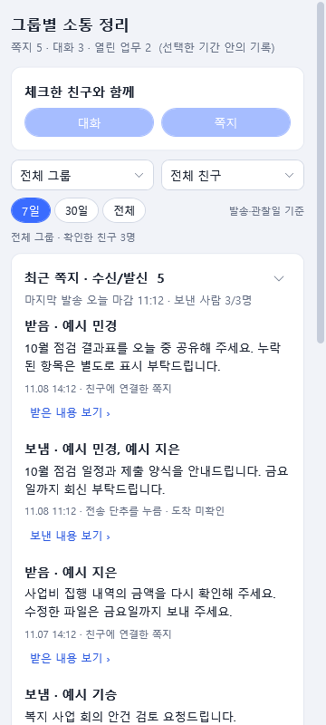
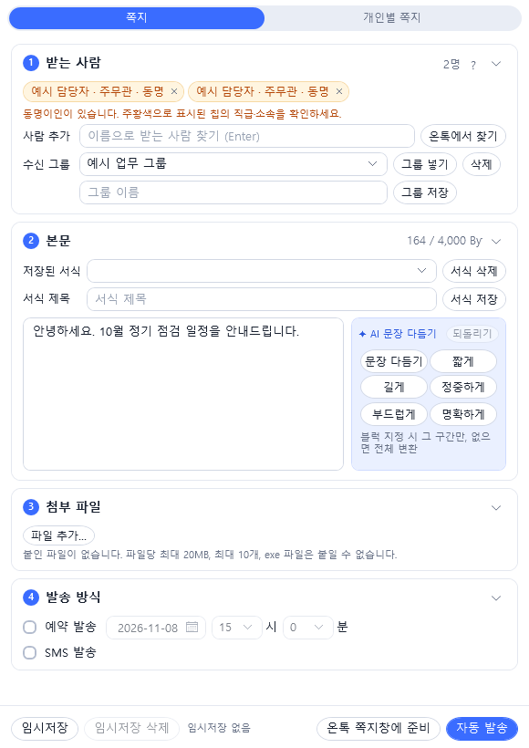
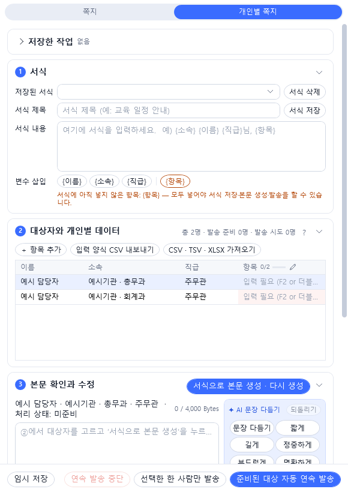
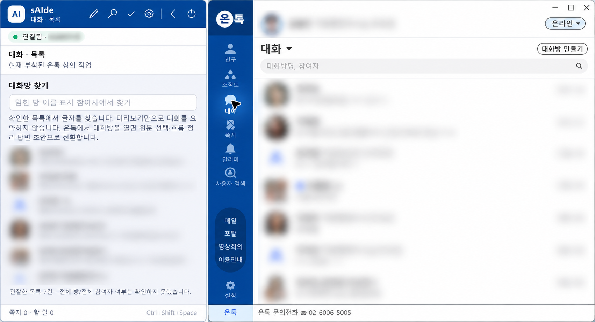
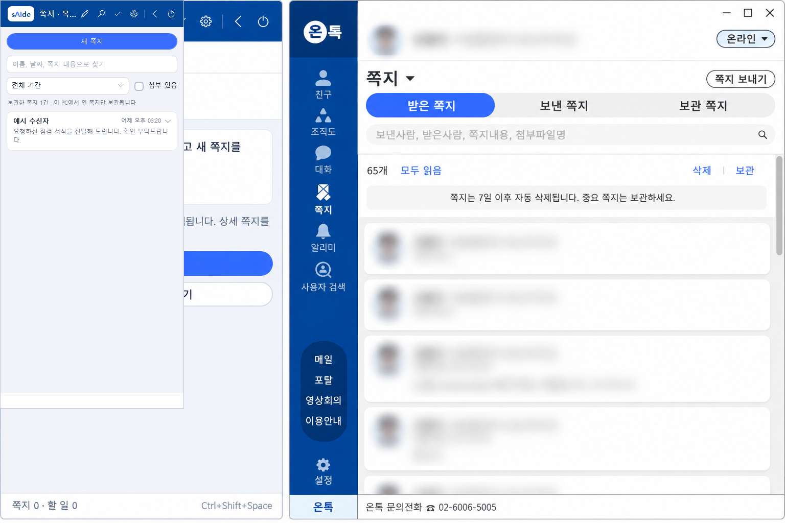
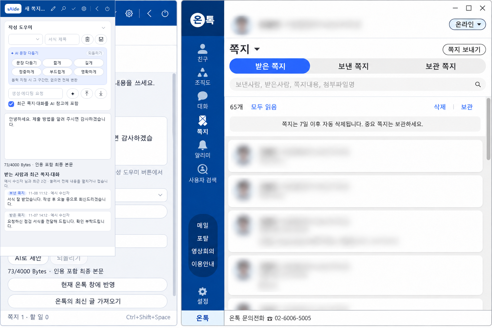

# onTalk.sAIde 사용자 매뉴얼

온톡에서 지금 하는 일에 맞춰 옆 패널이 바뀌는 Windows 업무 도우미입니다. Home(친구)에서는 친구·그룹별 업무 소통을 한눈에 보고, 조직도에서는 선택한 직원에게 쪽지를 보내며, 쪽지를 읽을 때는 내용과 할 일을 정리합니다. 쪽지 작성과 대화 답변에는 초안 편집과 로컬 AI 제안을 제공합니다.

**기준: 2026-10-17, 0.3.3 개발 소스.** Home 대시보드와 조직도 쪽지·개인화 작업을 포함합니다. [구현 현황](docs/implementation-status.md)과 [호환성 표](docs/compatibility-matrix.md)에서 확인 수준을 볼 수 있습니다.

## 목차

- [실행과 첫 연결](#실행과-첫-연결)
- [패널 조작](#패널-조작)
- [Home: 친구별 업무 소통](#home-친구별-업무-소통)
- [조직도: 선택 직원에게 쪽지](#조직도-선택-직원에게-쪽지)
- [대화: 방 찾기와 답변](#대화-방-찾기와-답변)
- [쪽지: 목록과 읽기](#쪽지-목록과-읽기)
- [쪽지 작성](#쪽지-작성)
- [검색·업무·첨부](#검색업무첨부)
- [로컬 AI](#로컬-ai)
- [백업과 자료 관리](#백업과-자료-관리)
- [문제 해결](#문제-해결)
- [개발과 문서 안내](#개발과-문서-안내)

## 실행과 첫 연결

### 최신 개발 빌드

Windows와 .NET SDK 10이 설치된 개발 PC의 PowerShell에서 실행합니다.

```powershell
Set-Location D:\Dev\onTalk.sAIde
dotnet build OnTalk.Sidecar.sln -c Release
& .\src\OnTalk.Sidecar.App\bin\Release\net10.0-windows\OnTalk.sAIde.exe
```

갱신할 때는 실행 중인 사이드카를 전원 단추로 먼저 종료하세요. DLL이 잠겨 빌드에 실패할 수 있습니다. 온톡은 계속 실행해도 됩니다.

### 배포 폴더

ZIP의 **전체 압축을 풀고** 안의 `OnTalk.sAIde.exe`를 실행합니다. EXE 하나만 옮기면 필요한 DLL이 없습니다. `scripts/publish.ps1`로 만든 묶음은 .NET 런타임을 포함합니다.

1. 온톡을 실행하고 로그인합니다.
2. 사이드카를 실행합니다.
3. 첫 연결 안내의 계정이 본인인지 확인하고 **이 계정으로 연결**을 누릅니다.
4. 온톡 메인 메뉴를 옮겨 패널 제목도 친구·조직도·대화·쪽지에 맞춰 바뀌는지 봅니다.

확인 전에는 쪽지 내용을 읽어 보관하지 않습니다. 확인한 계정은 다음 실행에서 다시 연결합니다. 계정 후보는 온톡 프로필 폴더 메타데이터로 추정하므로 직접 확인하세요.

개발 빌드와 0.3.3 배포본은 저장소 **스키마 11**입니다. 이전 DB 사본을 남기고 올리며 같은 저장소를 구버전 실행 파일과 번갈아 사용하지 마세요.

## 패널 조작

현재 쓰는 온톡 창 옆에 붙어 같은 높이로 따라갑니다. 오른쪽 공간이 부족하면 왼쪽에 붙고, 양쪽 공간이 없으면 온톡 가장자리에 좁은 도구를 표시합니다. 이때 펼치면 온톡 위에 겹칩니다.

| 도구 | 방법 |
|---|---|
| 접기 | 머리줄 `‹` 또는 패널에서 Esc |
| 펼치기 | 좁은 도구의 **AI**, 단축키(기본 **Ctrl+Shift+Space**), 알림 영역 아이콘 |
| 새 초안 | 연필. 작성 중에는 확장 작성 도우미 |
| 검색 | 돋보기. 이 계정에 보관한 자료 검색 |
| 업무 | 체크 아이콘. 할 일·기한·완료 상태 |
| 관리 | 톱니바퀴. 모델·백업·복구·삭제 |
| 종료 | 전원, 알림 영역 **끝내기**, `OnTalk.sAIde.exe --quit` |

다른 앱을 쓰면 숨고 온톡으로 돌아오면 나타납니다. 단축키로 직접 연 패널은 온톡을 다시 사용할 때까지 표시를 유지합니다. 단축키는 누를 때마다 패널이 접혔다 펴지며(접으면 좁은 도구는 계속 보임), 톱니 단추의 **관리 → 단축키**에서 바꿉니다. 입력칸을 누르고 키 조합을 누르면 키가 눌리는 대로 보이고 마지막 키를 누르는 순간 적용·저장됩니다. Ctrl·Alt·Win 중 하나를 포함해야 하며, 복사·붙여넣기 같은 기본 편집 조합과 다른 프로그램이 쓰는 조합은 거절합니다(Esc로 취소, **기본값**으로 복원). 종료해도 온톡은 종료되지 않습니다.

**Windows 시작 시 자동 실행**: 알림 영역 아이콘을 오른쪽 클릭해 같은 이름의 항목을 체크하면 현재 사용자(HKCU Run)에 등록합니다. 관리자 권한이 필요 없고, 다시 누르면 해제합니다. 자동 실행으로 뜰 때(`--autostart`)는 온톡이 실행될 때까지 최대 3분 기다린 뒤 시작합니다. 그 안에 온톡이 뜨지 않아도 패널은 열리고 온톡이 뜨면 자동으로 붙습니다. 폴더를 옮겼거나 새 버전으로 바꾸면 다음 실행 때 등록 경로를 현재 실행 파일로 고칩니다. 직접 실행했을 때의 동작은 그대로입니다.

**메인 화면 · 메뉴 확인 필요**가 나오면 아래 메뉴 선택으로 직접 지정할 수 있습니다. 사이드카 화면만 바꾸며 온톡 메뉴·사람 선택을 바꾸지 않습니다. 자동 감지가 회복되면 자동으로 돌아갑니다. 사용자 검색·알리미는 전용 지원 대상에서 제외하며 공통 도구만 제공합니다.

아래 메인 화면 이미지는 **실제 온톡과 사이드카를 각각 캡처해 나란히 편집한 안내 이미지**입니다. 얼굴·이름·계정·소속·본문 등은 AI 이미지 편집으로 강하게 흐림 처리했습니다. 편집 과정에서 크기·간격이 달라질 수 있으며 픽셀 단위 검증 자료는 아닙니다. ‘합성 예시’는 실제 WPF 화면을 가상 자료로 렌더링한 것입니다. [이미지 제작 기록](docs/manual-images.md)에서 출처와 개인정보 처리를 확인할 수 있습니다.

## Home: 친구별 업무 소통



“이 그룹에 어떤 쪽지를 보냈고, 최근 무슨 이야기를 나눴으며, 무엇을 이어서 확인할까?”를 그룹별로 보여주는 화면입니다. 핵심 3가지만 남겼습니다. 온톡 친구·그룹 편집이나 메시지 작성 기능은 각 원래 화면에서 사용합니다.

1. 온톡 **친구(Home)**에서 그룹을 펼칩니다.
2. 사이드카의 **전체 그룹 / 전체 친구**에서 그룹(또는 친구)을 고릅니다. 확인 가능한 온톡의 선택 신호도 필터에 반영합니다.
3. **7일 / 30일 / 전체**로 기간을 고릅니다.
4. **최근 쪽지(수신/발신) 5건 → 최근 대화 3건 → 최근 업무 3건**을 읽습니다. 쪽지마다 받음/보냄을 표시하고, 마지막 발송 시각과 이 그룹 중 쪽지를 보낸 사람 수, 기록별 상대·내용·전송 상태를 볼 수 있습니다. 나머지는 **이전 쪽지**·**이전 대화 정리**를 펼쳐 봅니다.
5. 여러 명과 바로 연락하려면 온톡 친구 목록에서 친구나 그룹을 체크한 뒤 사이드카의 **대화** 또는 **쪽지** 단추를 누릅니다. 사이드카가 체크한 친구를 우클릭해 온톡의 **단체 대화 / 단체 쪽지** 메뉴를 대신 누르고, 새 창이 열렸는지 확인합니다. 체크 상태는 바꾸지 않습니다.

**받은 쪽지:** 보관한 쪽지 중 친구에 연결한 쪽지와, 발신자 이름이 구성원과 같은 연결 전 쪽지(‘발신자 이름 일치 · 연결 전’)를 함께 보여줍니다.

**보낸 쪽지:** 사이드카의 작성 도우미로 보낸 쪽지 기록 중 수신자 이름이 선택한 그룹 구성원과 일치하는 것만 보여줍니다. 온톡 작성 창이 수신자를 이름으로만 보여 주므로 동명이인은 구분하지 못하며, 범위에 동명이인이 있으면 안내합니다. ‘전송 단추를 누름’은 상대 도착까지 확인한 것이 아닙니다. 온톡에서 직접 보낸 쪽지는 포함되지 않습니다.

대화 요약은 **친구에게 직접 연결한 자료만** 포함하며 원문 관찰일 기준입니다. 열린 업무는 선택 기간 밖의 오래된 미완료 업무도 포함합니다. 온톡 전체 이력이 아닙니다.

**대화 연결:** 대화창의 **원문 선택 → 정리**에서 분석한 뒤 **이 친구의 Home에 정리 연결**을 누릅니다. 선택한 친구와 함께 원문·AI 요약·근거를 계정별 암호화 저장소에 보관합니다. Home의 **요약 근거 보기**에서 다시 확인하거나 연결을 해제합니다. 아직 요약하지 않은 방이나 전체 대화 이력을 자동 수집하지 않습니다.

관찰한 친구·그룹 범위가 없으면 그룹을 펼치라는 안내를, 연결한 자료가 없으면 자료 연결 방법을 표시합니다. 자세한 화면 역할과 집계 규칙은 [Home 재설계](docs/home-dashboard.md)를 참고하세요.

## 조직도: 선택 직원에게 쪽지


온톡 **조직도**에서 선택해 둔 직원에게 같은 쪽지나 사람마다 다른 쪽지를 보낼 때 사용합니다. 담당자 검색·보관 그룹·AI 검색어 제안은 제공하지 않습니다.

1. 온톡 **조직도**에서 필요한 부서를 펼치고 직원이나 부서를 선택합니다. 사이드카가 읽은 선택 직원이 목록에 표시됩니다.
2. 보내지 않을 사람은 **제외(X 아이콘)** 단추로 제외합니다. 추가할 사람이 있거나 온톡이 선택 상태를 알려 주지 않으면 우측 상단 **직원 추가(+)** 단추를 눌러 읽은 직원 중에서 직접 검색하고 선택합니다.
3. **쪽지** 단추를 누르면 `쪽지 보내기` 창이 열리고, 선택한 직원이 `쪽지`와 `개인별 쪽지` 두 탭에 똑같이 들어갑니다. 먼저 `쪽지` 탭에서 같은 내용을 보냅니다. ① 받는 사람을 확인(✕로 빼기)하고 ② 본문을 쓰거나 저장된 서식을 불러온 뒤 ③ 보낼 **첨부 파일**을 **파일 추가…**로 고르거나 끌어다 놓고(파일당 최대 20MB·최대 10개, exe 제외) ④ 필요하면 예약 시각과 **SMS 발송**을 고릅니다. 새 쪽지·답장·선택 직원 쪽지가 모두 같은 창을 씁니다. **자동 발송**은 빈 새 쪽지 창을 자동으로 열어 모든 대상을 받는 사람에 넣고, 첨부 파일은 온톡의 파일 선택창으로 직접 붙이며 파일마다 온톡 첨부 목록에 늘었는지 확인합니다. SMS는 온톡의 ‘SMS 발송’ 확인란을 선택하고, 본문·첨부·SMS·예약을 검증한 뒤 확인 창에서 승인하면 한 통으로 보냅니다. **온톡 쪽지창에 준비**는 채우기만 하고 전송은 온톡 창에서 직접 합니다. 한 사람이라도 이름·직급·소속으로 확정하지 못하면 일부에게만 보내지 않고 멈춥니다. 본문은 자동 저장되지 않으며, 창 아래 왼쪽 **임시저장**을 눌러야 저장되고 **임시저장 삭제**로 바로 지울 수 있습니다.


4. 사람마다 내용이 다르면 같은 창의 **개인별 쪽지** 탭으로 옮깁니다(발송·준비가 진행되는 동안에는 탭을 바꿀 수 없습니다). **입력 양식 CSV 내보내기**로 받은 파일에 원하는 헤더(열)를 자유롭게 추가하고 사람별 데이터를 채운 뒤 **CSV · TSV · XLSX 데이터 가져오기**로 불러오면, `{이름}`, `{소속}`, `{직급}`과 함께 추가한 `{헤더명}` 변수를 서식에 그대로 적용해 개인별 본문을 생성·미리보기·수정합니다. 이름·소속·직급이 일치하지 않으면 가져오지 않으며, 개인별 발송은 한 건씩 수신자·본문·예약을 확인하며 진행합니다.



접힌 부서의 직원·읽히지 않은 직원은 대상에 없습니다. 동명이인은 이름·직급·소속을 함께 비교합니다. 자세한 순서는 [조직도 쪽지 안내](docs/organization-personalized-notes.md)를 참고하세요.

## 대화: 방 찾기와 답변



메인 **대화**의 **대화방 찾기**에 방 이름·표시 참여자의 글자를 입력합니다. 관찰한 목록 안에서 찾으며 미리보기로 대화 전체를 요약하지 않습니다. 온톡에서 방을 열면 **대화 지원**으로 바뀝니다.

다음은 **대화창 지원 합성 예시**입니다. 개인정보를 흐림 처리한 메인 대화 목록과 별도 대화창에 붙는 패널의 가상 자료 화면을 함께 배치했습니다. 한 시점의 실제 부착 화면을 뜻하지 않습니다.


| 탭 | 순서와 결과 |
|---|---|
| **원문 선택** | 사용할 텍스트를 체크하거나 **최근 10건** |
| **정리** | **선택한 원문 흐름 정리** → 요약·결정·질문·요청 후보와 인용 근거 확인 |
| **답변** | 직접 글을 쓰거나 **선택한 원문으로 답변 제안** → 비교 → **제안을 초안에 수락** → 필요하면 **되돌리기** |
| **업무** | 원문·제목·인용·기한 선택 → **원문 근거와 함께 업무 등록** |

새 메시지가 와도 선택한 원문·초안을 자동 교체하지 않습니다. 변화 안내를 보고 **다시 읽기**를 누른 뒤 원문을 다시 고릅니다. 한 번의 AI 처리는 최대 80건·본문 합계 12,000자입니다.

**현재 대화 답변은 ‘초안 복사’로 사용합니다.** 온톡의 실제 상대에게 붙여넣고 글을 확인한 뒤 직접 전송하세요. 입력 글 가져오기·비교·직접 반영은 합성 시험용 구현이 있지만 실제 입력 요소를 확인하지 못해 제품에 노출하지 않습니다.

전체 이력·첨부·이미지·시스템 알림을 모두 읽는 것은 아닙니다. 발신자 근거가 없으면 ‘발신자 미확인’입니다. 대화 원문과 AI 정리는 기본적으로 메모리에서 사용합니다. 업무로 등록한 텍스트, 작성한 초안, **Home에 직접 연결한 선택 원문과 AI 정리**는 보관됩니다.

## 쪽지: 목록과 읽기



메인 **쪽지**에서 **보관한 쪽지에서 찾기**로 로컬 보관 자료를 검색하고 **새 쪽지 준비**로 초안을 시작합니다. 온톡 받은·보낸·보관 목록 전체를 가져오는 기능은 아닙니다.

이번 수정은 실제 경로 `#/notes`와 `받은 쪽지·보낸 쪽지·보관 쪽지` 탭을 인식합니다. 목록 로딩 중에도 경로로 감지합니다. 메뉴 감지와 모든 쪽지 수집은 별개입니다.

### 받은 쪽지 읽기


메인 화면 옆에 **받은 쪽지 상세창용 패널 합성 예시**를 배치한 안내 이미지입니다. 실제 사용에서는 온톡에서 연 상세창 옆에 붙습니다.

1. 온톡에서 받은 쪽지를 엽니다. 연결 계정의 쪽지를 안정적으로 읽으면 자동 보관합니다.
2. **정리**에서 요약·요청·기한·업무 후보를 확인합니다.
3. 근거 문장을 보고 내가 맡을 항목을 체크해 **선택한 항목을 업무로 등록**합니다.
4. **원문**에서 실제 문장·첨부를 확인합니다.
5. 답변이 필요하면 초안을 준비하고 온톡에서 실제 답장창을 엽니다.

AI가 없으면 원문에서 할 일로 보이는 문장을 그대로 추린 후보를 제공합니다. AI 요약과 기한은 원문을 확인하세요. 본문에 없는 기한이나 담당자를 자동 확정하지 않습니다.

앱이 켜져 있는 동안 열어 읽은 받은 쪽지만 보관합니다. 온톡에는 7일 이후 삭제 안내가 있으므로 남길 쪽지는 그 전에 열고 첨부도 따로 저장해 가져오세요. 온톡의 보관 단추와 사이드카 로컬 사본은 별개입니다.

쪽지 상세에 연도·초·고유 번호가 없으면 일부 시각은 추정해 표시합니다. 같은 사람이 같은 분에 같은 본문을 두 번 보내면 한 건으로 합쳐질 수 있습니다. 보낸·보관 쪽지 상세 수집은 실제 미검증입니다.

## 쪽지 작성



메인 화면과 **새 쪽지 작성창용 패널 합성 예시**입니다. 실제 사용에서는 온톡에서 연 해당 작성창 옆에 붙습니다. 메뉴를 옮겨도 작성 중인 초안은 유지됩니다.

| 종류 | 준비할 내용 |
|---|---|
| 새 쪽지 | 목적·핵심 사실·요청사항 |
| 답장 | 원문의 질문·요청에 대한 응답 |
| 전체답장 | 모두에게 필요한 응답과 실제 전체 수신자 확인 |
| 전달 | 전달 이유·다음 행동·원문·첨부 포함 여부 |

1. 온톡에서 작성창을 열면 해당 작성창에 맞춤 부착된 패널이 표시됩니다. 작성창 세션·종류(새 쪽지, 답장, 전체답장, 전달)별로 초안을 분리 보관하며, 온톡 창이 열려 있는 동안 주기적으로 자동 저장됩니다.
2. **저장된 서식 관리**: 상단 **작성 도우미**에서 저장된 서식을 선택해 즉시 불러올 수 있으며, 서식 제목을 적고 **서식 저장()** 단추를 누르면 현재 초안을 새 서식으로 저장합니다. 필요 없어진 서식은 **서식 삭제()**로 지웁니다.
3. **✦ AI 문장 다듬기**:
   - 6가지 원클릭 프리셋 단추를 제공합니다: **문장 다듬기**(맞춤법·자연스러운 표현), **짧게**(군더더기 축약), **길게**(배경·안내 보완), **정중하게**(공공기관 격식 경어체), **부드럽게**(완곡한 어조), **명확하게**(핵심 용건 정리).
   - **블럭 구간 또는 전체 변환**: 본문에서 특정 문장이나 단락을 마우스/키보드로 블럭 지정하면 해당 구간만 다듬고, 선택이 없으면 전체 본문을 다듬습니다. 원문의 줄 바꿈과 빈 줄(문단 구분) 구조를 그대로 유지합니다.
   - 변환 결과가 마음에 들지 않으면 즉시 **되돌리기** 단추를 눌러 직전 본문으로 복원할 수 있습니다.
4. **생성·에디팅 요청 및 빠른 액션 단추**:
   - 요청 입력칸에 구체적인 요청(예: *제출 기한 연장 문의*, *점검 일정 안내*)을 적고 **✦ (AI로 제안)** 단추를 누르면, AI가 요청에 맞는 본문을 만들어 초안 칸에 바로 넣습니다(되돌리기로 복원 가능).
   - ** (현재 온톡 창에 반영)**: 작성한 초안을 온톡 쪽지창 본문으로 즉시 입력합니다(전송 단추는 누르지 않음).
   - ** (온톡의 최신 글 가져오기)**: 온톡 쪽지창에 적힌 본문을 초안 칸으로 가져옵니다.
5. **받는 사람과 최근 쪽지·대화 3건**:
   - 쪽지의 수신자가 확정되면 해당 직원과 이 PC에 로컬 보관된 이전 쪽지(받은 쪽지, 보낸 쪽지) 및 Home에 연결된 대화 정리 내역 중 최신 3건을 카드로 표시합니다.
   - 각 카드는 [받음]/[보냄]/[대화] 구분 배지, 일시, 상대 이름, 내용 미리보기를 담고 있으며, 카드를 클릭하면 본문 전체를 펼치거나 접을 수 있습니다.
   - 보관된 최근 내역이 있으면 **"최근 쪽지·대화를 AI 참고에 포함"** 확인란이 나타나며, 체크 시 AI 제안 생성 시 이전 소통 맥락과 어조를 참고하여 작성합니다.
6. 원문 인용 포함 여부(`원문 인용 포함 (N Bytes)`)와 실시간 바이트 계산(`N / 4,000 Bytes`)을 확인한 뒤 ** (온톡 창에 반영)** 단추로 온톡 본문에 넣고, 최종 내용을 확인한 후 온톡에서 직접 전송합니다.

**반영은 전송이 아닙니다.** 온톡 본문·바이트를 다시 읽어 확인합니다. 미완성 `{확인할 내용}`은 먼저 고치세요. 종류·창 세션별로 초안을 나누고 바뀐 작업에는 오래된 AI 제안을 적용하지 않습니다.

연필로 **확장 작성 도우미**를 열면 큰 편집 화면·보관 초안·수신자·예약 도구를 사용할 수 있습니다. 초안 복구는 본문을 불러오며 수신자·예약을 자동 복원하지 않습니다.

### 수신자·예약·전송

- **수신자:** **온톡에서 찾기**로 검색하고 직급·소속을 확인해 추가합니다. 조직도 선택 직원을 준비한 것만으로 실제 수신자가 추가되지는 않습니다.
- **예약:** 날짜·시각을 고르고 **온톡에 설정**한 뒤 실제 표시를 확인합니다. 등록된 예약의 조회·수정·취소는 온톡에서 합니다.
- **전송:** 확장 도우미 **전송…**에서 받는 사람·본문·예약·SMS 상태를 확인하고 확인 창에서 승인합니다. 일반 작성 패널은 전송 단추를 제공하지 않습니다.

과거 즉시 전송 1건과 사용자 보고에 따른 예약 전송 성공 기록이 있습니다. 최신 네 작성 종류의 실제 전송 검증을 모두 마쳤다는 뜻은 아닙니다. 작성창이 닫히는 것까지 확인하며 배달 완료를 보장하지 않습니다. 불확실한 결과를 자동 재전송하지 않습니다. 온톡에서 직접 넣은 수신자는 소속 근거가 없어 ‘이름만 확인’으로 표시될 수 있습니다.

## 검색·업무·첨부

### 검색

돋보기에서 발신자·본문·첨부파일명·추출한 첨부 내용의 글자를 찾습니다. 임베딩 모델이 있으면 뜻이 비슷한 쪽지도 참고 결과로 제공합니다. 관련 없는 결과가 섞일 수 있으므로 문자 일치와 구분해 원문을 확인하세요. 대화 전체 자동 보관·검색은 제공하지 않습니다.

### 업무

쪽지 후보를 선택하거나 대화 업무 탭에서 원문·인용·제목·기한을 정해 등록합니다. 할 일 목록에서 완료 상태를 관리합니다. 기한이 있는 업무는 **전날 오전 9시·당일 오전 9시** 알림 규칙을 사용합니다. 앱이 꺼져 있으면 해당 시각 알림을 보장하지 않습니다. 대화 업무 상세에는 등록 당시 원문과 출처가 남습니다.

### 첨부

1. 온톡에서 파일을 직접 **저장**합니다.
2. 받은 쪽지 **원문 → 가져오기**로 저장한 파일을 선택합니다.
3. 보관 상태를 확인하고 필요하면 내보냅니다.

온톡 저장 단추를 자동으로 누르지 않습니다. 원본은 암호화하고 내보낼 때 무결성을 확인합니다. 텍스트(UTF-8·CP949)·DOCX·XLSX·PPTX 내용 추출을 지원합니다. PDF·HWP·이미지는 원본 보관만 가능하며 내용 추출·OCR은 없습니다. 추출 실패와 보관 실패를 구분합니다.

## 로컬 AI

AI는 선택 사항입니다. 없어도 쪽지 보관·글자 검색·수동 업무·초안 직접 작성·복사를 사용할 수 있습니다. 요약·검색어 제안·뜻 검색·AI 초안에는 모델이 필요합니다.

Ollama와 생성·임베딩 모델을 준비합니다. 현재 기본 모델은 다음과 같습니다. 다운로드나 오프라인 이관은 별도 준비해야 합니다.

```powershell
ollama pull gemma4:e2b
ollama pull bge-m3
```

**관리 → 로컬 AI 모델 → 설치된 모델 확인**에서 정리·초안 모델과 뜻 검색 모델을 골라 **모델 저장**합니다. 사이드카를 다시 실행한 뒤 적용됩니다.

AI 요청은 `127.0.0.1:11434`로 제한하며 클라우드 모델로 원문을 보내는 경로는 없습니다. Ollama 자체의 다운로드·업데이트 통신을 차단하는 것은 아니며 네트워크 차단 환경의 전체 동작은 별도 검증 대상입니다.

## 백업과 자료 관리

경로는 `%LOCALAPPDATA%\OnTalk.sAIde\profiles\<온톡 계정>\`입니다. 쪽지·업무·초안·그룹·자료 연결은 SQLCipher DB, 첨부는 AES-GCM 암호화입니다. 키는 Windows DPAPI로 보호해 같은 PC의 같은 Windows 사용자가 사용합니다.

**이동:** 관리에서 백업 암호를 두 번 입력하고 **백업 파일 만들기…**를 누릅니다. 다른 PC에서 같은 온톡 계정으로 연결해 **백업에서 되살리기…**를 사용합니다. 폴더 복사만으로는 열 수 없고 암호를 잊으면 백업을 열 수 없습니다. 다른 PC 수용 검증은 아직 남아 있습니다.

계정 변화가 감지되면 이전 저장소·분석·작업창을 닫고 새 계정을 확인합니다. 실제 다른 계정 전환의 전체 시험은 완료하지 않았습니다.

**이 계정의 보관 자료 모두 지우기…**는 해당 계정의 쪽지 사본·업무·초안·문구·그룹·파일·검색 자료를 삭제합니다. 되돌릴 수 없으므로 필요한 백업을 먼저 준비하세요. 온톡 자체의 쪽지는 지우지 않습니다.

기관의 원문 보관·보존기간 규정에 따라 사용하세요. 온톡 설치 파일·실행 옵션·메신저 DB를 수정하거나 직접 읽어 동기화하지 않고 화면 접근성에서 관찰한 내용을 사용합니다.

## 문제 해결

| 증상 | 확인 방법 |
|---|---|
| 패널이 안 보임 | 온톡 활성화 → 단축키(기본 Ctrl+Shift+Space) 또는 알림 영역 아이콘 |
| 이미 실행 중 | 기존 인스턴스 사용 또는 정상 종료 후 재실행 |
| 쪽지 메뉴 미확인 | 최신 빌드인지 확인. `#/notes` 감지는 수정됨. 계속 실패하면 수동 메뉴 지정 |
| 사람 선택이 안 따라옴 | 온톡 신호가 안 읽힐 수 있음. 사이드카에서 직접 체크 |
| 담당자 후보가 없음 | 온톡 부서·사람·상세를 표시. 기관 전체 검색이 아님 |
| 대화 원문이 일부만 보임 | 날짜·텍스트가 표시되게 하고 **다시 읽기** |
| 대화 입력 반영 단추 없음 | 현재 제품은 **초안 복사** 지원. 직접 입력은 미검증으로 비노출 |
| 검색 결과 없음 | 계정·보관 여부 확인. 온톡 목록 전체를 가져오지 않음 |
| AI 실패 | Ollama 실행·설치 모델·관리 설정 확인. 수동 기능은 계속 사용 |
| 본문 충돌 | 온톡 최신 글 확인·가져오기. 자동 덮어쓰지 않음 |
| 배율·위치 문제 | 창을 줄여 공간 확보. 실제 125/150% 도킹은 추가 검증 대상 |
| 빌드 파일 잠금 | 사이드카 정상 종료 후 빌드. 온톡 종료 불필요 |

기존 실제 확인 환경은 온톡 5.4.3·Windows 11 Pro·배율 100%입니다. 현재 설치·실행 버전은 **온톡 5.4.9**이며, 새 버전에서 Home(친구)의 문맥·목록 읽기를 확인했습니다. 2026-10-17 사용자 확인에 따라 5.4.9(5.4.9.0 포함)를 확인된 버전으로 등록했습니다. 기능별 기존 검증 범위는 호환성 표에 기록합니다. 싱글창·높은 배율·다른 PC·오프라인 배포도 추가 검증 대상입니다. 자세한 범위는 [호환성 표](docs/compatibility-matrix.md)를 참고하세요.

## 개발과 문서 안내

최신 결과는 **테스트 403개 통과·합성 WPF 화면 88개·Release 오류·경고 0개**입니다. Home은 그룹·친구 필터, 대화 정리 연결, 360px 폭·낮은 높이·125/150% 렌더링으로 검증했습니다. 기존 실제 감시→파서 경로에서 친구·조직도·대화 목록·일대일/그룹 대화·로그인 전환·쪽지 메뉴를 확인했습니다. 새 Home과 조직도 개인별 발송의 실제 사용 수용 시험은 별도로 남아 있습니다.

```powershell
dotnet test tests/OnTalk.Sidecar.Tests -c Release
dotnet build OnTalk.Sidecar.sln -c Release
dotnet run --project tools/OnTalk.ContextPreview -c Release -- artifacts/context-preview-phase4
```

`--no-restore`는 패키지를 이미 복원한 환경에서만 사용합니다. 읽기 전용 `OnTalk.ContextPreview.exe --inspect follow`는 개수·문맥만 표시하며 본문·계정·이름을 결과 파일에 저장하지 않고 입력·전송하지 않습니다. 10분 뒤 종료합니다.

`powershell -File scripts/publish.ps1`는 테스트 후 런타임·README·문서·이미지를 묶습니다. 0.3.3 배포본은 `artifacts/OnTalk.sAIde-0.3.3-win-x64` 폴더와 같은 이름의 ZIP입니다.

| 문서 | 내용 |
|---|---|
| [구현 현황](docs/implementation-status.md) | 현재 제공 기능·남은 작업 |
| [조직도 쪽지 안내](docs/organization-personalized-notes.md) | 수신자 선택·개인별 데이터(CSV/XLSX) 파일·발송 순서 |
| [호환성](docs/compatibility-matrix.md) | 실제 확인·자동 시험·미확인 범위 |
| [메뉴별 설계](docs/contextual-sidecar-design.md) | 역할·전체 목표 |
| [1차](docs/contextual-sidecar-implementation.md) / [2차](docs/contextual-sidecar-phase2.md) / [3차](docs/contextual-sidecar-phase3.md) / [4차](docs/contextual-sidecar-phase4.md) | 당시 구현·시험과 후속 변경 |
| [컨셉·계획](docs/concept-and-plan.md) | 주요 결정과 최신 방향 |
| [연동 검증](docs/feasibility-results.md) | 접근성·입력·예약 조사 이력 |
| [초기 설계](docs/design-and-implementation-plan.md) / [검토](docs/plan-review.md) | 초기 목표·기술 검토 |
| [이미지 제작 기록](docs/manual-images.md) | 개인정보 처리·합성 예시 구분 |

| 폴더 | 역할 |
|---|---|
| `src/OnTalk.Sidecar.Core` | 문맥·근거·날짜·바이트·알림 규칙 |
| `src/OnTalk.Sidecar.Automation` | 창 추적·MSAA 읽기·쪽지 조작 |
| `src/OnTalk.Sidecar.Storage` | 계정별 암호화 저장소·파일·백업 |
| `src/OnTalk.Sidecar.AI` | 로컬 분석·임베딩·초안 |
| `src/OnTalk.Sidecar.App` | WPF 패널과 작업창 |
| `tools/OnTalk.Probe` / `tools/OnTalk.ContextPreview` | 구조 진단 / 합성 화면·문맥 검사 |
