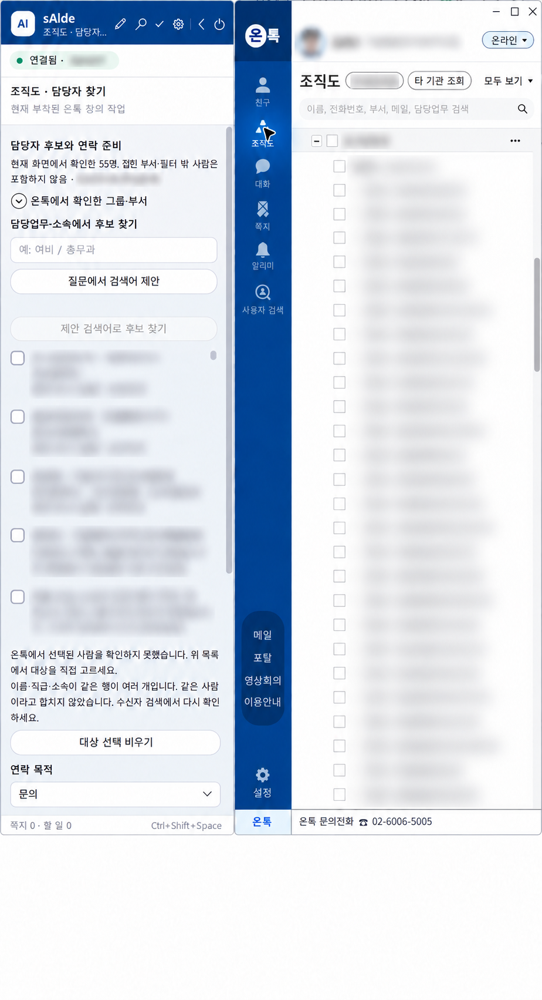
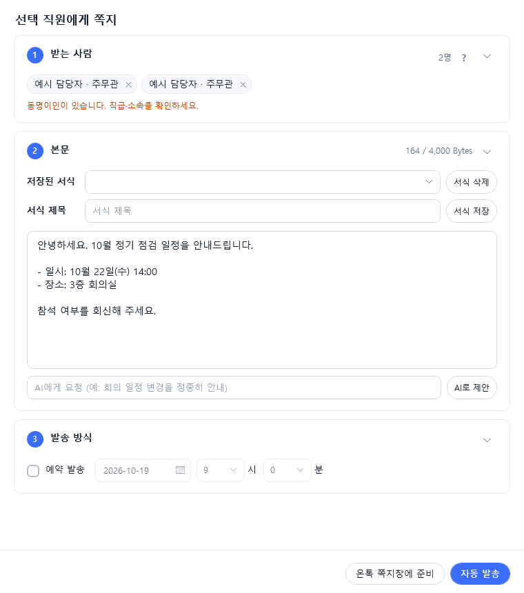
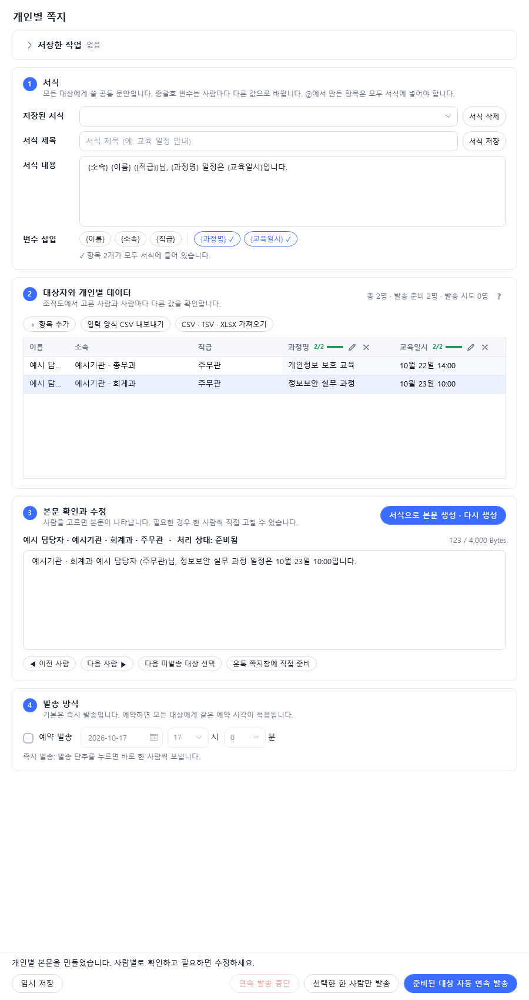

# 조직도 쪽지 · 2026-10-17 개발 구현

## 사용 순서

1. 온톡 조직도에서 직원이나 부서를 선택한다. 사이드카가 읽은 선택 직원이 목록에 나타난다. 접힌 부서와 읽히지 않은 구성원은 포함하지 않는다. 체크 상태는 온톡 화면 요소의 CSS 클래스(IAccessible2)로 읽는다. 그래도 인식되지 않는 화면에서는 `온톡 선택이 표시되지 않으면 직접 고르기`에서 읽은 직원을 체크한다.
2. 목록에서 보내지 않을 사람을 `제외(X 아이콘)`한다. 온톡의 선택이 바뀌면 제외 표시는 초기화한다. 추가할 직원이 있으면 우측 상단 `직원 추가(+)`로 검색해 넣는다. 표시 정보가 같은 중복 행은 임의로 합치지 않는다.
3. 동일 본문을 보낼 때는 `선택 직원에게 쪽지 보내기`를 누른다. 개인별 쪽지 창과 같은 카드 구성의 `선택 직원에게 쪽지` 창이 열린다: `① 받는 사람`(대상 칩, ✕로 이번 쪽지에서 빼기, 동명이인 경고, `?` 안내), `② 본문`(저장된 서식 불러오기·서식 저장/삭제, Bytes 수, AI 제안), `③ 발송 방식`(즉시 또는 예약). 단추는 창 아래에 고정된다.
   - `자동 발송`: 확인 창에서 인원·대상·본문·발송 방식을 승인하면, 빈 `새 쪽지` 창을 찾거나 자동으로 열어 대상마다 이름·직급·조직이 유일하게 일치한 사람만 받는 사람에 추가하고, 본문 반영·예약 설정 후 전송 직전 검증을 거쳐 한 통으로 보낸다. 전송 단추를 누르기 전에 발송 기록을 남기며, 결과가 불확실하면 이 창에서 다시 보내지 않는다.
   - `온톡 쪽지창에 준비`: 같은 순서로 채우고 검증까지만 한다. 전송은 온톡 창에서 직접 한다.
   - 이름·직급·소속이 같은 대상은 받는 사람 칩이 빨간 바탕·테두리에 `중복`(그룹이 여럿이면 `중복1`, `중복2`) 표시로 나타나 어느 사람인지 바로 보이며, 경고 문구도 빨간색이다. 이름만 같은 동명이인은 주황색 칩에 `동명`으로 표시한다. 빨간 칩 중 하나만 남기고 ✕로 빼면 표시가 사라진다.
   - `온톡에서 찾기`는 온톡 새 쪽지 창의 `추가`로 열리는 사용자 검색을 빌려 쓴다. 검색용으로 새로 연 빈 `새 쪽지` 창과 검색 창은 결과를 읽은 뒤 닫고, 이 작업 창을 다시 앞으로 가져와 결과를 `① 받는 사람`에 보여 준다. 이미 열려 있던 빈 새 쪽지 창이나 내용이 들어 있는 작성 창은 닫지 않는다.
   - 같은 쪽지를 모두가 받으므로, 한 사람이라도 확정하지 못하면(일치 없음·동명이인) 일부에게만 보내지 않고 멈춘다. 그 대상을 빼거나 온톡 창에서 직접 고른다.
   - 본문은 자동으로 저장하지 않는다. 창 아래 왼쪽 `임시저장` 단추를 누를 때만 계정 저장소에 저장되며, 저장해 둔 본문은 다시 열면 이어진다. 옆의 `임시저장 삭제` 단추로 저장해 둔 쪽지를 바로 지울 수 있고(화면의 본문은 그대로 남는다), 발송을 마치면 임시저장도 지운다. 저장 시각은 단추 옆에 표시된다.

4. 사람마다 다른 내용이면 `선택 직원에게 개인별 쪽지 보내기`를 누른다. 작성 도우미를 거치지 않고 `개인별 쪽지 · 작성과 미리보기` 창이 바로 열리며, 여러 명 각 개인에 대한 온톡 쪽지 창을 수동으로 열거나 `반영할 온톡 창`에서 일일이 지정할 필요 없이 자동 연속 발송할 수 있다.

제거한 기능: 담당업무·소속 글자 검색, AI 검색어 제안, 부서 범위 선택, 연락 목적별 초안, 연락 준비 그룹 저장·불러오기, 사람 상세·보관 쪽지 후보와 직접 연결. 저장소의 `contact_preparation_group` 테이블은 기존 DB 호환을 위해 남기며 더 이상 읽거나 쓰지 않는다.

## 개인별 내용 및 자동 연속 발송

`개인별 쪽지 · 작성과 미리보기` 창은 작업 단위별 카드로 나뉜다. 모든 구역(①~④)은 제목 줄 오른쪽 화살표나 제목을 눌러 접고 펼 수 있으며 기본은 펼친 상태다. 위에서부터 제목 `개인별 쪽지`, 접고 펼 수 있는 `저장한 작업` 구역(저장한 작업이 없으면 접힌 채로, 있으면 펼친 채로 열린다. 목록의 각 줄에 서식 제목과 발송 대상 인원수, 삭제용 `X` 단추가 있어 고른 작업을 바꾸지 않고 불러오기 전에도 바로 지울 수 있다. 열려 있는 작업을 지우면 창도 닫힌다), `① 서식`(저장된 서식 선택·서식 제목·서식 내용·변수 삽입 단추), `② 대상자와 개인별 데이터`(표·CSV/XLSX 가져오기·준비/발송 인원 요약), `③ 본문 확인과 수정`(선택한 사람의 본문·Bytes 수·이전/다음 사람 이동), `④ 첨부 파일`(모든 대상에게 같은 파일, 파일당 20MB·10개·exe 불가), `⑤ 발송 방식`(즉시 또는 예약, SMS 발송)이며, 발송·중단·임시 저장 단추와 진행 상황은 창 아래에 항상 고정되어 보인다. 서식은 제목과 내용을 따로 저장하며 저장한 서식은 제목 목록에서 골라 불러온다(작성 도우미의 서식과 같은 저장소를 쓴다). ②의 표에는 별도의 처리 상태 열이 없다. 값이 비어 있는 항목 칸은 연한 붉은 바탕에 회색 `입력 필요 (F2 or 더블클릭)`로 보이고, 값이 있으면 값만 보인다. 항목 열 제목 옆에는 입력 현황(예: `3/53`)과 작은 진행 막대가 표시되며 모두 채우면 초록색이 된다. 발송 시도·보류·작성 중인 줄은 처리 상태에 따라 칸 바탕색만 바뀐다(초록 완료 · 주황 확인 필요 · 빨강 오류). 자세한 처리 상태는 줄에 마우스를 올리거나 ③의 선택 정보 줄에서 본다. 표 사용법은 ② 카드 오른쪽 위의 책 아이콘을 누르면 안내 풍선으로 볼 수 있다. 작업은 자동으로 저장하지 않는다. 저장소에 기록되는 때는 `임시 저장` 단추(Ctrl+S)를 누를 때와 발송할 때뿐이며, 저장하지 않은 변경이 있는 채 창을 닫거나 다른 저장 작업을 불러오려 하면 임시 저장할지 묻는다(예: 저장하고 진행 / 아니오: 저장하지 않고 진행 / 취소). `저장한 작업` 목록에서 사용자가 `임시 저장`으로 저장했고 아직 발송을 시도하지 않은 작업에는 `임시 저장` 태그가 붙는다(작업에 임시 저장 표시를 따로 기록한다). 모든 대상의 발송·예약이 끝난 작업에는 초록 `발송 완료` 태그가, 발송을 시도했지만 아직 끝나지 않은 작업(보류·결과 불명·미진행 대상이 있는 경우)에는 주황 `일부 발송` 태그가 붙는다. 발송 도중 남은 저장과 이전 버전이 창을 닫을 때 자동 저장한 작업에는 태그가 없으며, `표시 없는 작업 정리` 단추로 임시 저장 표시도 발송 기록도 없는 작업을 확인 후 한꺼번에 지울 수 있다. 각 줄에는 서식 제목과 발송 대상 인원수가 보인다. 저장한 서식을 불러오면 항목 구성도 서식에 맞춘다: 서식에 쓰인 변수는 항목으로 추가되고, 서식에 없으면서 입력한 값도 없는 항목(기본으로 만들어 둔 `항목` 등)은 지워진다. 값이 들어 있는 항목은 데이터 보호를 위해 남기며 서식에 넣으라는 경고가 표시된다. 서식에 새로 쓴 `{변수}`는 본문 생성 때 ②의 입력 열로 자동 추가된다.

항목(사람마다 다른 값을 넣는 열)는 ②에서 관리한다. `＋ 항목 추가`로 열을 늘리고, 열 머리의 `✎`로 제목을 바꾸며(서식의 `{제목}`과 사람별 값도 함께 따라간다), `✕`로 열을 지운다(서식의 변수도 함께 지워지며 최소 한 개는 남는다). 이름·소속·직급과 같은 제목, 중복 제목, 중괄호가 든 제목은 쓸 수 없다. 항목은 서식의 필수 항목이라 ①에서 모두 `{항목}` 형태로 서식 내용에 들어 있어야 하며, 빠진 것이 있으면 ①에 주황색 경고가 보이고 서식 저장·본문 생성·준비·발송을 막는다. ①의 `변수 삽입` 줄에는 항목 개수만큼 단추가 생기며 누르면 서식 입력칸의 커서 위치에 들어간다(서식에 들어 있는 것은 ✓ 표시).

창의 기본 제공 변수는 조직도에서 읽은 `{이름}`, `{소속}`, `{직급}`이며, 특정 서식이나 고정된 항목(예: 평점·기간 등)을 강제하지 않는다.

사람별 데이터를 준비하려면 `입력 양식 CSV 내보내기`로 선택 대상의 `이름,소속,직급`이 담긴 CSV 파일을 저장한다. 사용자는 이 파일의 첫 행에 필요한 헤더(열) 이름을 자유롭게 추가하고 각 대상 행에 데이터를 입력한 뒤 `CSV · TSV · XLSX 데이터 가져오기`를 누른다. UTF-8·CP949 CSV, TSV 및 첫 번째 엑셀 시트를 읽는다. `이름`, `소속`, `직급` 열은 대상 식별을 위해 필수이며, 사용자가 추가한 모든 헤더명이 그대로 `{헤더명}` 변수와 화면 표의 열로 반영된다. 선택 대상과 파일 행이 한 명씩 정확히 대응하지 않으면 아무 데이터도 반영하지 않고 오류를 표시한다. 이미 발송을 시도한 대상의 값과 본문은 바꾸지 않는다.

이름·소속·직급은 선택 당시 조직도 정보를 사용하며 파일이나 입력값으로 덮어쓰지 않는다.

`서식으로 본문 생성 · 다시 생성`을 누르면 공통 서식의 `{이름}`, `{소속}`, `{직급}` 및 사용자가 추가한 `{헤더명}` 변수를 각 사람의 데이터로 치환해 본문을 생성한다. 누락값, 파일 헤더에 없는 변수, 빈 본문, 치환 후 4000바이트 초과를 검사한다. 재생성 시 미발송 대상의 개별 편집 내용을 바꿀지 확인한다.

- **자동 연속 발송 (`준비된 대상 자동 연속 발송`)**:
  - 시작 시 1회 확인 대화상자에서 전체 발송 인원·대상 미리보기·발송 방식(즉시 발송 또는 일괄 예약 시각)을 확인한다.
  - 미발송 대상을 첫 번째부터 끝까지 자동으로 순회하며:
    1. 이미 열려 있는 빈 `새 쪽지` 창을 찾고, 없으면 온톡 본창을 쪽지(`#/notes`) 화면으로 전환해 `쪽지 보내기`를 눌러 빈 `새 쪽지` 창을 자동으로 연다.
    2. `받는 사람 추가` 창에서 해당 직원을 검색해 `이름·직급·소속`이 유일하게 일치하는 1명을 대조한다. 일치하는 수신자가 없거나 동명이인을 하나로 확정할 수 없는 경우 검색 창을 닫아 해당 대상만 `보류` 처리하고, 빈 새 쪽지 창을 그대로 사용해 다음 사람 발송을 계속 진행한다.
    3. 수신자 1명을 추가하고 개인별 본문을 반영한 뒤, `예약 발송`이 체크된 경우 지정한 예약 일시를 설정한다.
    4. 전송 직전 온톡 창의 수신자·본문·바이트 수·예약 시각·SMS 해제를 검증하고, 발송 기록(`BeginDispatch`)과 작업 상태를 먼저 저장한 뒤 `전송`을 눌러 창이 닫히는지 확인한다.
  - 진행 중 언제든 `연속 발송 중단` 단추로 현재 사람 처리 후 안전하게 멈출 수 있으며, `선택한 한 사람만 발송`으로 특정 인원 1명만 자동 발송할 수도 있다.

작업의 대상 정보·헤더별 입력 데이터·본문은 계정별 암호화 저장소에 보관한다. 발송 시도 전에 상태를 남기고, 재실행 후에도 시도한 대상을 자동 재발송하지 않는다. 오래된 편집기 저장이 발송 기록이나 확정 본문을 되돌리지 않도록 보존한다. `작성창 닫힘`은 배달 완료가 아니다. 결과 불명은 온톡 보낸 쪽지함에서 확인한다.

## 저장소

스키마 10에 `personalized_work`를 추가했다. 기존 마이그레이션 절차가 이전 DB를 백업한 후 업그레이드한다. 기존 암호화 백업에 새 테이블도 포함된다. 구버전 실행 파일은 스키마 10을 열 수 없다.

## 검증

개인별 치환·사실값 보존·미완성 변수·바이트 한도·조직명 대조·계정 격리·작업 복구·오래된 저장의 발송 기록 보존·자동 연속 발송(순차 발송, 동명이인 보류 후 계속 진행, 예약 시각 적용, 창 미닫힘 시 중단 및 중복 발송 차단)을 자동 테스트한다. 합성 WPF 검증에 개인별 본문 생성·개별 수정 유지·자동 연속 발송·일반/작은 화면 렌더링을 포함했다.
